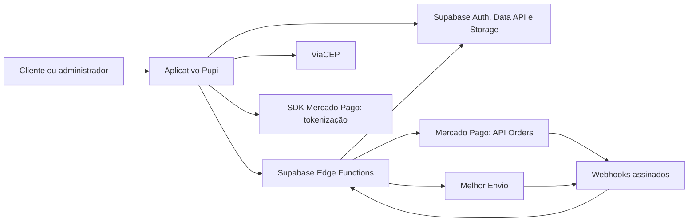

<p align="center">
  
</p>
<h1 align="center">Pupi</h1>
<p align="center">E-commerce petshop com experiência mobile, gestão administrativa e pagamentos dentro do aplicativo.</p>
<p align="center"><strong>JavaScript · Vite · Supabase · Mercado Pago · Melhor Envio</strong></p>
<p align="center">
  <a href="#inicio-rapido">Iniciar o projeto</a> ·
  <a href="#configuracao">Configuração</a> ·
  <a href="#pagamentos">Pagamentos</a> ·
  <a href="#deploy">Deploy</a> ·
  <a href="#documentacao">Documentação</a>
</p>

O Pupi reúne catálogo, conta do cliente, carrinho, checkout e administração em uma aplicação web responsiva. O frontend usa JavaScript modular, sem framework de interface, com animações GSAP, ícones Lucide e recursos de PWA. O Supabase fornece autenticação, PostgreSQL, Storage e Edge Functions; integrações sensíveis são executadas no servidor.

**Estado atual:** cotação de frete, confirmação de pedido, cartão e Pix foram testados pelo usuário no ambiente de testes. O pagamento usa **Checkout Transparente via API Orders**, sem redirecionar o comprador para um checkout externo. A preparação técnica para homologação em produção foi concluída; troca de credenciais, testes reais de recebimento e etapas operacionais pendentes estão descritos neste documento e no [guia de pagamentos](docs/payment-production.md).

## Conteúdo

- [Funcionalidades](#funcionalidades)
- [Tecnologias e arquitetura](#arquitetura)
- [Requisitos](#requisitos)
- [Início rápido](#inicio-rapido)
- [Configuração do Supabase](#configuracao)
- [Primeiro administrador e catálogo](#administracao)
- [Pagamentos com Mercado Pago](#pagamentos)
- [Frete, remessas e NF-e](#frete)
- [Deploy na Vercel](#deploy)
- [Testes e comandos](#testes)
- [Estrutura do repositório](#estrutura)
- [Segurança e operação](#seguranca)
- [Solução de problemas](#problemas)
- [Limites e próximos passos](#limites)
- [Documentação e licença](#documentacao)

<a id="funcionalidades"></a>

## Funcionalidades

| Área | Recursos |
| --- | --- |
|  Loja | Catálogo público de produtos publicados, categorias, busca, ordenação, paginação, detalhes do produto e banners responsivos com troca automática. |
|  Conta | Cadastro, confirmação de e-mail, login, recuperação de senha, Google OAuth configurável, perfil e endereços. Consulta ViaCEP com preenchimento assistido e edição manual. |
|  Compra | Carrinho por cliente, conferência de preço e estoque no servidor, cotação de frete e confirmação idempotente de pedido. |
|  Pagamento | Cartão e Pix no pedido, desafio 3DS incorporado, recuperação de tentativa, consulta automática limitada e webhook assinado. |
|  Administração | Resumo, categorias, produtos, imagens, banners mobile/desktop, movimentações de estoque, pedidos, clientes, configurações e associação de chave NF-e. |
|  Logística | Cotação Melhor Envio, preparação de remessa no carrinho do provedor, receptor de eventos assinados e acompanhamento manual. Registro e eventos dependem de configuração e homologação próprias. |
|  Experiência | Interface responsiva, navegação mobile, indicadores de produtos no carrinho e pedidos aguardando pagamento, fontes locais DM Sans e Nunito Sans, notificações compactas abaixo do menu, loading, movimento reduzido e PWA instalável em navegadores compatíveis. |
|  Integridade | RLS, permissões explícitas, operações transacionais, auditoria, snapshots de pedido e identificação de compras de teste. |

<a id="arquitetura"></a>

##  Tecnologias e arquitetura

| Camada | Tecnologia | Responsabilidade |
| --- | --- | --- |
| Interface | HTML, CSS e JavaScript ES Modules | Telas, navegação por hash e componentes compartilhados. |
| Build | Vite 8 | Desenvolvimento local e geração de arquivos estáticos. |
| Movimento e ícones | GSAP 3 e Lucide | Animações de interface e iconografia vetorial. |
| Identidade | Supabase Auth | Sessão, e-mail/senha, recuperação e OAuth. |
| Dados | PostgreSQL e Supabase Data API | Catálogo, clientes, pedidos, estoque, RLS e RPCs. |
| Mídia | Supabase Storage | Imagens privadas com acesso controlado e URLs assinadas. |
| Backend | Supabase Edge Functions | Autenticação de operações, frete, pagamentos e webhooks. |
| Integrações | Mercado Pago, Melhor Envio e ViaCEP | Pagamento, logística e consulta de CEP. |
| Qualidade | Node.js Test Runner, PGlite e Playwright | Testes de aplicação, banco e navegador. |
| Hospedagem | Vercel | Publicação do frontend gerado em `dist/`. |



O frontend envia identificadores e dados permitidos. O servidor consulta titularidade, preços e estoque e valida as respostas dos provedores. Valores monetários são armazenados em centavos; pedidos preservam o histórico de itens e endereço. O status operacional do pedido, o estado financeiro e os eventos da entrega têm controles próprios.

<a id="requisitos"></a>

## Requisitos

- **Node.js 24.x** e npm, conforme `package.json`.
- Git e acesso ao repositório para instalação por clone.
- Navegador atualizado com JavaScript habilitado.
- Projeto Supabase com as migrations aplicadas e chave pública moderna `sb_publishable_`.
- Contas e credenciais dos provedores para habilitar frete e pagamento.
- Docker somente para executar a pilha Supabase completa localmente. Os testes de banco com PGlite não exigem Docker.

As versões de dependências resolvidas ficam no `package-lock.json`. Use `npm ci` para reproduzir a instalação. A CLI Supabase está incluída nas dependências de desenvolvimento.

<a id="inicio-rapido"></a>

##  Início rápido

### 1. Obter e instalar

```sh
git clone https://github.com/JS171555/pupi.git
cd pupi
git switch main
npm ci
```

### 2. Configurar o frontend

```sh
cp .env.example .env
```

No PowerShell, use `Copy-Item .env.example .env`; no Prompt de Comando, `copy .env.example .env`.

O arquivo deve conter apenas a configuração pública:

```dotenv
SUPABASE_URL=https://SEU_PROJECT_REF.supabase.co
SUPABASE_PUBLISHABLE_KEY=sb_publishable_SUA_CHAVE_PUBLICA
```

O `.env.example` já aponta para o ambiente Pupi. Para uma implantação independente, substitua **os dois valores** pelos do seu projeto. Executar o frontend localmente com esse exemplo conecta ao banco hospedado informado; não cria um banco isolado.

Os nomes não usam o prefixo `VITE_`: `vite.config.js` injeta explicitamente somente essas duas variáveis no cliente. O `.env` não é versionado. Nunca adicione Access Token, `service_role`, `sb_secret_`, senha de banco ou segredos OAuth ao frontend.

### 3. Executar

```sh
npm run dev
```

Abra **http://localhost:3000**. Use `http://localhost:3000/#/loja` para acessar o catálogo diretamente. Não abra `index.html` por `file://`.

A aplicação depende do Supabase para dados e sessão. Sem produtos cadastrados e publicados, o catálogo fica vazio; não há carga automática de produtos ou usuários de demonstração.

### 4. Conferir o build

```sh
npm run build
npm run preview
```

A saída é `dist/`. O preview também usa a porta 3000; encerre o servidor de desenvolvimento antes de iniciá-lo. O terminal informa o endereço efetivo se houver outra aplicação usando a porta.

<a id="configuracao"></a>

##  Configuração do Supabase

### Projeto hospedado

Para um **projeto novo e dedicado**, autentique a CLI, vincule o destino e confira as migrations antes de aplicar:

```sh
npx supabase login
npx supabase link --project-ref SEU_PROJECT_REF
npx supabase migration list --linked
npx supabase db push --dry-run
```

Revise o projeto vinculado e a lista exibida. Somente então aplique:

```sh
npx supabase db push
```

**No projeto Pupi existente**, a fundação foi inicialmente criada sem registro completo no histórico. Não reaplique a fundação nem execute `db push` sem comparar o schema e regularizar o histórico. Consulte [a configuração do banco](docs/setup.md) e `npx supabase migration repair --help`; não marque migrations como aplicadas sem conferir o que existe no destino.

Mantenha somente `public` exposto à Data API. O schema `private` guarda rotinas e registros internos e não deve ser exposto. As migrations definem tabelas, permissões, RLS, buckets e regras de integridade.

Depois de configurar o frontend, execute:

```sh
npm run verify:remote
```

Essa verificação acessa o catálogo anonimamente e confere a recusa de leitura dos perfis. Ela usa a rede e o projeto configurado; não valida sozinha login, entrega de e-mail, upload ou pagamento.

### Autenticação, e-mails e Google

O `supabase/config.toml` descreve o ambiente **local**. Suas opções não configuram automaticamente o dashboard hospedado.

No Supabase Auth, configure:

1. Login por e-mail e senha, cadastro e confirmação de e-mail.
2. Senha mínima de 12 caracteres, com maiúscula, minúscula e número; rotação de refresh token e troca segura de senha.
3. SMTP e remetente para confirmação e recuperação em ambiente hospedado.
4. **Site URL** com a origem principal do app.
5. **Redirect URLs** exatas para cada origem utilizada:

```text
http://localhost:3000/?auth_callback=signup
http://localhost:3000/?auth_callback=oauth
http://localhost:3000/?auth_callback=recovery
https://SEU_DOMINIO/?auth_callback=signup
https://SEU_DOMINIO/?auth_callback=oauth
https://SEU_DOMINIO/?auth_callback=recovery
```

Se usar `127.0.0.1`, outra porta ou domínio de preview, cadastre também as URLs correspondentes. Em produção, use HTTPS.

Para Google, crie um cliente OAuth Web no Google Cloud e configure a URI autorizada:

```text
https://SEU_PROJECT_REF.supabase.co/auth/v1/callback
```

Habilite Google em **Authentication → Providers**, informando Client ID e Client Secret no Supabase. O segredo não pertence à Vercel nem ao `.env` do frontend. Enquanto o aplicativo Google estiver em teste, autorize as contas de teste no Google Cloud. E-mail/senha continua disponível sem Google configurado.

A recuperação usa PKCE: abra o link no mesmo navegador em que iniciou a solicitação. Veja [o guia de Auth](docs/phase-2-setup.md) para detalhes.

### Edge Functions

O repositório contém cinco funções publicáveis:

| Função | Finalidade | Autenticação |
| --- | --- | --- |
| `pupi-checkout` | Cotar frete e confirmar pedido. | JWT e usuário validado. |
| `pupi-shipping-register` | Registrar remessa no carrinho Melhor Envio. | JWT e administrador validado. |
| `pupi-shipping-webhook` | Receber eventos de etiquetas vinculadas. | Assinatura HMAC do Melhor Envio. |
| `pupi-mercadopago-checkout` | Iniciar e consultar pagamento incorporado. | JWT e titularidade do pedido. |
| `pupi-mercadopago-webhook` | Receber notificações financeiras. | Assinatura HMAC do Mercado Pago. |

Após aplicar as migrations e configurar os segredos, publique no projeto vinculado:

```sh
npx supabase functions deploy pupi-checkout
npx supabase functions deploy pupi-shipping-register
npx supabase functions deploy pupi-shipping-webhook
npx supabase functions deploy pupi-mercadopago-checkout
npx supabase functions deploy pupi-mercadopago-webhook
```

A CLI lê `verify_jwt` de `supabase/config.toml`. Preserve JWT nas operações do app e HMAC nos dois webhooks; não desabilite a verificação globalmente para resolver uma falha de autenticação. Se não houver Docker disponível para empacotar o deploy, a CLI oferece `--use-api`.

`SUPABASE_URL`, `SUPABASE_ANON_KEY` e `SUPABASE_SERVICE_ROLE_KEY` são fornecidos pelo ambiente hospedado das funções. A chave privilegiada fica exclusivamente no backend.

Para segredos dos provedores, prefira **Edge Functions → Secrets** no dashboard. Como alternativa, preencha um arquivo local ignorado pelo Git, por exemplo `supabase/.env.functions.local`, e envie pela CLI autenticada:

```sh
npx supabase secrets set --env-file supabase/.env.functions.local
```

As variáveis exigidas estão nas seções de pagamento e frete abaixo. Não copie os exemplos com placeholders como se fossem credenciais válidas.

### Pilha completa local — opcional

Com Docker em execução, use um banco local separado:

```sh
npx supabase start
npx supabase migration list --local
```

Configure o `.env` com a URL local e uma chave `sb_publishable_` compatível. O cliente não aceita a chave JWT legada `anon` como substituta. A caixa de e-mails local usa, por padrão, **http://127.0.0.1:54324**.

Para executar as funções com credenciais de teste locais:

```sh
npx supabase functions serve --env-file supabase/.env.functions.local
```

Quando precisar reconstruir o banco de desenvolvimento, `npx supabase db reset --local` apaga os dados **locais** e reaplica as migrations. Não use essa operação para atualizar o projeto hospedado. Dados em `tests/database/platform.sql` são exclusivos dos testes e nunca devem ser aplicados ao Supabase.

<a id="administracao"></a>

## Primeiro administrador e catálogo

Nenhuma conta se torna administradora automaticamente. Cadastre e confirme a conta, identifique seu UUID em **Authentication → Users** e atribua o papel por uma operação confiável no banco:

```sql
-- Substitua pelo UUID da conta já cadastrada. Executar somente como operador autorizado.
update public.user_roles
set role = 'admin'
where user_id = 'UUID_DA_CONTA'::uuid
returning user_id, role;
```

A operação deve retornar a conta esperada. Se não retornar linhas, confira o cadastro e o UUID. A aplicação não oferece promoção de papel pelo navegador e não autoriza administradores com base em e-mail ou metadados editáveis.

Entre com a conta e abra **http://localhost:3000/#/admin**. Para preparar a primeira compra:

1. Em **Configurações**, salve nome, contato e CEP de origem com oito dígitos.
2. Crie uma **categoria ativa** e um produto associado, com SKU único e preço válido.
3. Informe peso em **gramas** e dimensões em **milímetros** para os produtos enviados.
4. Cadastre imagens e registre entrada de estoque em **Estoque**. O saldo inicial de um produto novo é zero.
5. Ative e publique o produto. Cadastre o endereço da conta compradora, adicione ao carrinho e revise o pedido.

As imagens aceitas são JPEG, PNG e WebP, até **5 MiB por arquivo**. Os buckets `product-images`, `category-images` e `banner-images` são privados; o catálogo usa URLs assinadas, com validade de cinco minutos. Produtos com histórico devem ser arquivados quando a exclusão definitiva não for permitida.

### Banners da página inicial

Em **Administração → Banners**, crie um rascunho e envie uma imagem **mobile quadrada (1:1)** e outra **desktop horizontal (3:1)**. Tamanhos sugeridos: **1080 × 1080 px** e **1920 × 640 px**. Confira as prévias, marque **Exibir na loja** e salve. Posições menores aparecem primeiro; até oito banners ficam publicados. É possível editar, ocultar e excluir com confirmação.

A página inicial abre a loja. Banners publicados alternam automaticamente a cada seis segundos, com pausa e navegação; movimento reduzido começa pausado. Um único banner permanece estático. Não é necessário configurar novas credenciais. Consulte [operação, permissões e recuperação de uploads](docs/banners.md).

<a id="pagamentos"></a>

## Pagamentos com Mercado Pago

A integração ativa é **Checkout Transparente via API Orders**, com Payment Brick oficial dentro do Pupi. Cartão, Pix e desafio bancário 3DS permanecem na tela do pedido.

Configure os seguintes segredos no Supabase:

| Variável | Uso |
| --- | --- |
| `MERCADO_PAGO_ENV` | `sandbox` para testes ou `production` para pagamentos reais. |
| `MERCADO_PAGO_ACCESS_TOKEN` | Token privado da conta recebedora e aplicação compatíveis com API Orders. |
| `MERCADO_PAGO_PUBLIC_KEY` | Public Key correspondente à conta/aplicação. É fornecida ao SDK pelo backend. |
| `MERCADO_PAGO_COLLECTOR_ID` | User ID da conta recebedora, correspondente ao Access Token. |
| `MERCADO_PAGO_WEBHOOK_SECRET` | Assinatura secreta do webhook da aplicação e ambiente. |
| `MERCADO_PAGO_CHECKOUT_ENABLED` | `true` para habilitar; `false` para pausar as operações do checkout, incluindo sua consulta. |

**Sandbox:** use o par de credenciais da conta vendedora de teste compatível com **Orders**. Nesse contrato, o Access Token utiliza prefixo `APP_USR`; um token legado `TEST-` de outro contrato não deve ser usado. O servidor confere a conta e o ambiente antes de enviar o pagamento. Pix de teste usa o cenário oficial `APRO`, em que o provedor simula a aprovação; não faça transferência bancária para pagar essa simulação.

**Produção:** pause o checkout durante a troca, use o par de credenciais da aplicação da conta real, ajuste o `COLLECTOR_ID`, configure o webhook de produção e só então habilite o teste controlado. Não reutilize pedidos de sandbox para compras reais. A mudança de credenciais não foi automatizada.

No painel Mercado Pago, configure o evento **Order (Mercado Pago)** para:

```text
https://SEU_PROJECT_REF.supabase.co/functions/v1/pupi-mercadopago-webhook
```

O backend confirma vendedor, ambiente, valor, vínculo e resposta canônica antes de atualizar o pedido. Gravação financeira e vínculo da tentativa são atômicos. Mensagem do iframe 3DS ou callback do navegador não equivale a pagamento aprovado.

Pagamentos pendentes conhecidos são consultados automaticamente a cada oito segundos, por até dois minutos, com pausa offline ou com aba oculta. **Verificar pagamento** continua disponível. Uma falha incerta preserva a tentativa e a chave idempotente; não exige pagar novamente. Pix vencido deixa de exibir código/cópia sem inventar um estado financeiro. Pedidos de teste aparecem identificados e ficam fora dos totais financeiros pagos do painel.

O Pupi não inicia reembolsos nesta interface. Estorno total confirmado é refletido pelo backend; estorno parcial, contestação ou pagamentos múltiplos exigem conferência.

Siga o [roteiro completo de produção e homologação](docs/payment-production.md) para credenciais, 3DS, primeiro recebimento real, webhook e interrupção segura. O sucesso no sandbox não certifica recebimento em produção.

<a id="frete"></a>

## Frete, remessas e NF-e

### ViaCEP

O formulário consulta `https://viacep.com.br/ws/CEP/json/` após informar um CEP completo e preenche os campos disponíveis. Número, complemento e conferência do endereço continuam sob responsabilidade do cliente. CEP desconhecido ou falha na API permitem preenchimento manual; a consulta não usa credenciais.

### Melhor Envio

Configure os segredos no Supabase, sempre com os valores do ambiente escolhido:

| Variável | Obrigatória para |
| --- | --- |
| `MELHOR_ENVIO_ENV` | `sandbox` ou `production`; cotação e registro. |
| `MELHOR_ENVIO_TOKEN` | Token de acesso; cotação e registro. |
| `MELHOR_ENVIO_USER_AGENT` | Identificação da aplicação e contato técnico exigidos pelo provedor. |
| `MELHOR_ENVIO_SENDER` | Dados reais do remetente em JSON; registro de remessa. |
| `MELHOR_ENVIO_WEBHOOK_SECRET` | Validação HMAC dos eventos de etiqueta. |

O JSON do remetente exige `name`, `email`, `phone`, `state_register`, `address`, `number`, `district`, `city`, `postal_code`, `state_abbr` e exatamente um de `document` (CPF) ou `company_document` (CNPJ). `complement` é opcional. Use documentos e telefone somente com dígitos e CEP compatível com a origem cotada. Guarde esse JSON nos segredos; não publique dados fiscais no repositório.

O fluxo de compra gera cotações com validade de dez minutos. A confirmação reconfere carrinho, endereço, preços, origem, validade e estoque antes de reservar os itens e criar o pedido. **Confirmar um pedido não compra frete nem emite etiqueta.**

A remessa administrativa é adicionada ao carrinho Melhor Envio e depende de volumes válidos da cotação, dados das partes e NF-e externa. Compra do frete e emissão de etiqueta permanecem no provedor. Se houver resposta incerta no registro, confira o carrinho do Melhor Envio; não repita a operação até reconciliar o resultado.

O endpoint de eventos é:

```text
https://SEU_PROJECT_REF.supabase.co/functions/v1/pupi-shipping-webhook
```

Ele valida `X-ME-Signature` e processa somente etiquetas vinculadas a entregas Pupi. Os eventos não alteram automaticamente pagamento ou status operacional do pedido. A consulta automática de rastreamento ainda não foi implementada.

### Nota fiscal

A NF-e é emitida **externamente**. O administrador associa a chave de 44 dígitos ao pedido; o Pupi valida formato, modelo 55 e dígito verificador. Isso não emite a nota nem comprova autorização na SEFAZ.

Para Correios, Loggi e J&T com múltiplos volumes, falta a distribuição de itens por etiqueta. Azul exige dados adicionais do XML da NF-e. Esses casos permanecem limitados até a implementação e homologação correspondentes. Consulte [o guia de logística](docs/phase-4-setup.md).

<a id="deploy"></a>

## Deploy na Vercel

1. Importe `JS171555/pupi` e selecione a branch **main** para produção.
2. Use **Node.js 24.x** e as configurações presentes em `vercel.json`:

   | Opção | Valor |
   | --- | --- |
   | Framework | Vite |
   | Diretório raiz | Raiz do repositório |
   | Instalação | `npm ci` |
   | Build | `npm run build` |
   | Saída | `dist` |

3. Adicione `SUPABASE_URL` e `SUPABASE_PUBLISHABLE_KEY` aos ambientes desejados da Vercel.
4. Faça o deploy. Alterações nessas variáveis exigem **novo build/deploy**, pois os valores são incorporados ao bundle.
5. Configure Site URL e callbacks da origem publicada no Supabase Auth; complete o OAuth no Google quando utilizado.
6. Publique migrations e Edge Functions separadamente no Supabase. O deploy da Vercel publica somente o frontend.

Access Token Mercado Pago, tokens Melhor Envio, assinatura de webhook e `service_role` não pertencem à Vercel neste projeto. `MERCADO_PAGO_PUBLIC_KEY` também é configurada no Supabase e retornada ao frontend autenticado; não exige outra variável de build.

A navegação usa rotas como `/#/loja`, `/#/pedidos` e `/#/admin`; o hash é tratado pelo cliente. PWA, fontes locais e shell público ficam no frontend. Login, dados privados, consulta de frete e pagamentos precisam de conexão.

<a id="testes"></a>

## Testes e comandos

| Comando | Finalidade |
| --- | --- |
| `npm ci` | Instalar as dependências do lockfile. |
| `npm run dev` | Executar o servidor de desenvolvimento. |
| `npm run build` | Gerar os arquivos de produção em `dist/`. |
| `npm run preview` | Conferir localmente o build gerado. |
| `npm test` | Testar serviços, validações e integrações com respostas controladas. |
| `npm run db:test` | Aplicar migrations e testar integridade/permissões com PGlite. |
| `npm run check` | Executar os testes de aplicação e banco. |
| `npm run design:check` | Conferir consistência dos tokens de design. |
| `npm run design:generate` | Regenerar saídas dos tokens após mudança na fonte de design. |
| `npm run test:e2e` | Executar os testes Playwright. |
| `npm run verify:remote` | Verificar catálogo e proteção anônima de perfis no Supabase configurado. |

Para verificar uma instalação:

```sh
npm run check
npm run build
npm run design:check
npx playwright install chromium
npm run test:e2e
```

O Playwright usa Chromium de sistema em `/usr/bin/chromium` quando disponível; `CHROMIUM_PATH` permite informar outro binário. Em Linux/CI, use `npx playwright install --with-deps chromium` se também precisar das bibliotecas do sistema.

Os testes de banco não precisam de credenciais nem Docker. Os testes de navegador interceptam chamadas de rede para um projeto fictício, sem criar cobrança real. Eles não substituem homologação de Auth, e-mails, Storage, concorrência entre conexões, provedores ou webhooks reais. `npm run verify:remote` é a exceção: acessa o projeto hospedado configurado.

Os resultados e limites da última revisão financeira estão em [payment-production.md](docs/payment-production.md). Evitamos tratar testes com respostas controladas como prova de recebimento bancário.

<a id="estrutura"></a>

## Estrutura do repositório

```text
pupi/
├── index.html                  # Entrada do aplicativo
├── src/
│   ├── app.js                  # Navegação e composição das telas
│   ├── config/                 # Validação da configuração pública
│   ├── modules/                # Autenticação, conta, loja e administração
│   ├── repositories/           # Consultas e contratos de acesso aos dados
│   ├── services/               # Supabase, mídia, checkout e SDK de pagamento
│   ├── styles/                 # Estilos e tokens gerados
│   ├── ui/                     # Componentes, feedback e carregamento
│   └── utils/                  # Validações e tratamento de erros
├── public/                     # PWA, fontes e ícones do aplicativo
├── supabase/
│   ├── config.toml             # Pilha local e configuração das funções
│   ├── migrations/             # Schema, RLS, RPCs e integridade versionados
│   └── functions/              # Checkout, frete, pagamento e webhooks
├── tests/                      # Aplicação, banco e navegador
├── scripts/                    # Tokens e verificação de conexão
├── docs/                       # Guias operacionais e histórico das entregas
├── DESIGN.md                   # Direção visual e componentes
├── UX-CONTRACT.md              # Contratos de interação
├── .env.example                # Somente configuração pública de exemplo
├── package-lock.json           # Dependências resolvidas
├── vite.config.js              # Build e exposição explícita de variáveis
└── vercel.json                 # Deploy do frontend
```

<a id="seguranca"></a>

## Segurança e operação

- RLS e grants restringem acesso por titularidade e função. Controles do navegador não substituem autorização no banco/backend.
- Permissões administrativas vêm de `user_roles`, sem promoção automática ou uso de `user_metadata` para conceder acesso.
- Preço, estoque, total e estados financeiros são conferidos no servidor. A interface administrativa não marca pedidos como pagos.
- PAN/CVV não são armazenados pelo Pupi. O SDK tokeniza o cartão; tokens e dados de envio da tentativa ficam na memória, sem persistência em armazenamento do navegador ou logs.
- URLs do desafio 3DS são transitórias e validadas; a conclusão do desafio só dispara consulta ao servidor.
- O service worker armazena somente arquivos públicos permitidos. Dados de conta e APIs não entram no cache público da PWA.
- Logs usam diagnósticos controlados; não publique respostas integrais dos provedores, documentos ou segredos em issues.
- Remoções pendentes de mídia são tratadas pela administração; a fila não é um worker automático. Confira registros antes de repetir uma operação cuja resposta foi perdida.
- Mantenha backups e verifique as migrations antes de atualizar o banco. Não execute reset no projeto hospedado como procedimento de deploy.

Consulte a [matriz de permissões](docs/security.md). Para relatar falhas, use [as issues do repositório](https://github.com/JS171555/pupi/issues) sem expor informações sensíveis; vulnerabilidades com detalhes privados devem ser encaminhadas ao responsável pelo repositório em canal restrito.

<a id="problemas"></a>

## Solução de problemas

| Sintoma | O que conferir |
| --- | --- |
| Configuração ausente/inválida ao abrir | `.env`, URL de origem válida e chave `sb_publishable_`. Reinicie o Vite ou refaça o build após alterar variáveis. |
| Página não funciona ao abrir o HTML | Use `npm run dev` e o endereço HTTP informado pelo terminal. |
| Catálogo vazio ou sem produto recém-criado | Categoria ativa, produto ativo/publicado, vínculos e filtros. Uma instalação nova começa sem dados. |
| Acesso administrativo negado | Sessão da conta correta e registro `admin` em `public.user_roles`. Metadados do usuário não concedem privilégios. |
| E-mail não chega ou retorno de login falha | Confirmação, SMTP, limites do provedor, Site URL e callbacks exatos da origem utilizada. |
| Link de recuperação inválido | Abra no mesmo navegador da solicitação ou solicite novo link nessa origem. |
| Google indisponível | Provider no Supabase, cliente Web no Google, callback Supabase e contas autorizadas para teste. |
| Frete indisponível | Três segredos de cotação Melhor Envio, ambiente correspondente, CEP de origem, endereço, estoque e peso/dimensões dos produtos. |
| Cotação venceu ou carrinho mudou | Solicite nova cotação antes de confirmar. A validade é de dez minutos. |
| Loja precisa conferir a configuração do pagamento | API **Orders**, conta recebedora, ambiente, par de credenciais, `COLLECTOR_ID`, assinatura e habilitação. Preserve a tentativa existente. |
| Pagamento em verificação após timeout | Use **Verificar pagamento** no mesmo pedido. Não crie outra cobrança nem altere o status manualmente. |
| Pix de teste aprova sem transferência | Comportamento esperado do cenário oficial sandbox `APRO`. |
| Remessa com resposta incerta | Confira o carrinho Melhor Envio e solicite reconciliação técnica antes de tentar de novo. |
| Imagem não carrega ou exclusão fica pendente | Validade da URL assinada, vínculo, formato/tamanho do arquivo e fila de limpeza na administração. |
| Playwright não encontra navegador | Instale Chromium ou configure `CHROMIUM_PATH`. |
| CLI quer reaplicar a fundação | Interrompa o push e compare o schema com o histórico de migrations do projeto existente. |

<a id="limites"></a>

## Limites e próximos passos

A base atual está preparada para testes controlados. Permanecem as seguintes etapas operacionais:

- Homologar em produção cartão, Pix, 3DS, entrega do webhook, recusa, estorno e recuperação de conexão conforme o [roteiro financeiro](docs/payment-production.md).
- Configurar e homologar remetente, registro de remessa e eventos Melhor Envio. Compra de frete/emissão de etiqueta seguem no provedor.
- Implementar consulta automática de rastreamento, reconciliação de registro de remessa incerto e os casos logísticos de múltiplos volumes/XML descritos acima.
- Substituir as informações provisórias de uso e o identificador histórico `testing-v1` pelos Termos de Uso e Política de Privacidade definitivos, com atualização do controle de versão/aceite antes do lançamento público.
- Validar SMTP, OAuth, Storage e experiência real nos domínios/navegadores da implantação.

Não há emissão fiscal própria, compra automática de etiqueta, notificações push ou compra offline implementadas. A instalação como PWA não transforma essas funções em recursos disponíveis sem conexão.

<a id="documentacao"></a>

##  Documentação e licença

| Documento | Conteúdo |
| --- | --- |
| [Pagamentos em produção](docs/payment-production.md) | Configuração atual, progresso, homologação e interrupção segura. |
| [Auth e contas](docs/phase-2-setup.md) | Callbacks, Google, recuperação, SMTP e aceite. |
| [Administração](docs/phase-3-setup.md) | Catálogo, estoque, mídia e operação administrativa. |
| [Checkout e logística](docs/phase-4-setup.md) | Melhor Envio, NF-e, remetente, remessas e limites. |
| [Progresso de logística](docs/phase-4-progress.md) | Entregas realizadas e tarefas que permitem retomar o trabalho. |
| [Histórico de pagamentos](docs/phase-5-plan.md) | Evolução da integração, diagnósticos e validações por etapa. |
| [Configuração da fundação](docs/setup.md) | Banco, CLI, Storage e histórico inicial. |
| [Arquitetura da fundação](docs/architecture.md) | Modelo de dados e decisões originais de integridade. |
| [Permissões e segurança](docs/security.md) | Fronteiras de acesso e proteção dos recursos. |
| [Polimento da interface](docs/interface-polish.md) | Alterações visuais, decisões preservadas e verificações. |
| [Banners](docs/banners.md) | Upload mobile/desktop, publicação, carrossel e limpeza de imagens. |
| [Design](DESIGN.md) e [UX](UX-CONTRACT.md) | Identidade visual, componentes e comportamento das telas. |

Os documentos de fases preservam o contexto da época e podem citar branches ou pendências já superadas. Para instalar e operar a versão atual, siga este README; para pagamentos, use primeiro `docs/payment-production.md`. Não execute uma instrução antiga de API Payments ou reaplicação de banco como se fosse a configuração atual de Orders.

**Responsável pelo repositório:** [JS171555](https://github.com/JS171555). O `package.json` declara o projeto como `private` e `UNLICENSED`; não há licença open source concedida para redistribuir o aplicativo.

Os ícones deste README são SVGs locais derivados do [Lucide](https://lucide.dev), com a licença original preservada em [LICENSE.lucide](docs/assets/readme/LICENSE.lucide). Bibliotecas, fontes e demais recursos mantêm suas licenças próprias.
